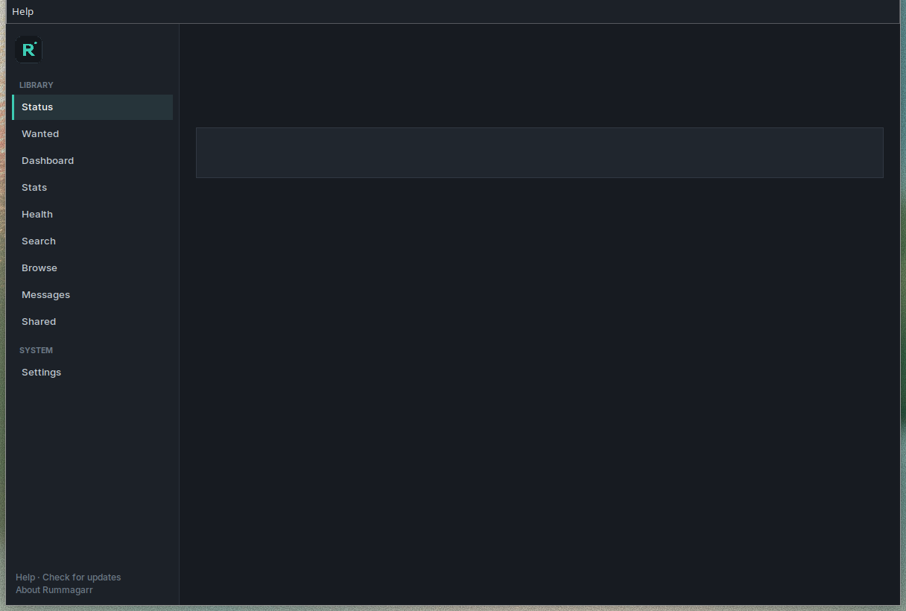
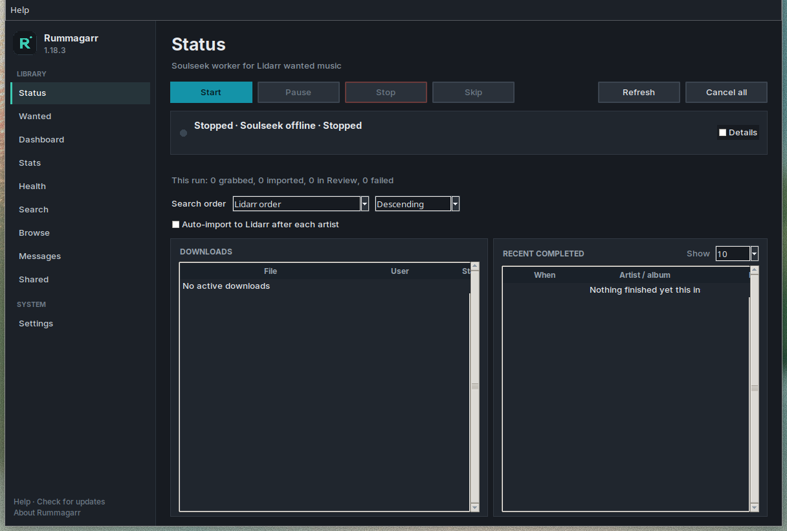
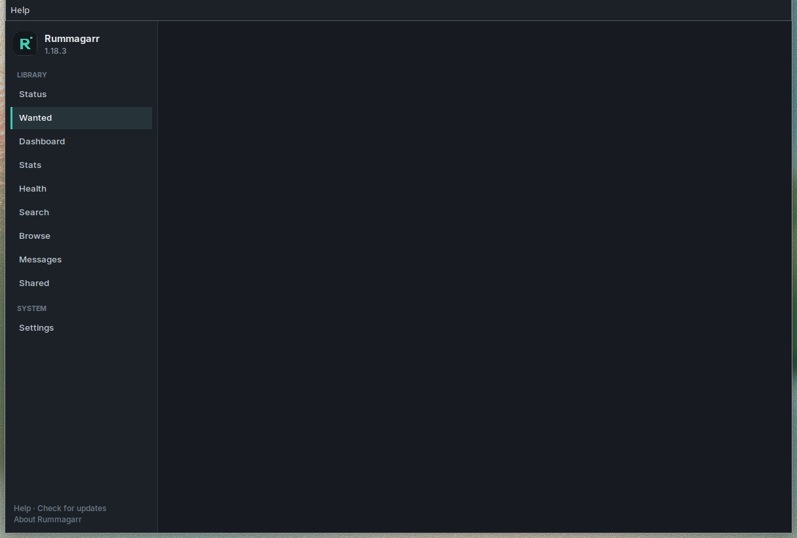

# Rummagarr

Rummagarr fills the albums and tracks Lidarr still wants. It searches Soulseek, downloads the files, and asks Lidarr to import and rename them. It is a Windows desktop app. No Docker. No slskd.

**Version 1.19.1.** The GitHub repository is [T2112/rummagarr](https://github.com/T2112/rummagarr).

Only download music you have the rights to. Soulseek is a peer-to-peer network, and you are responsible for what you download and what you share.

[Sponsor Rummagarr](https://github.com/sponsors/T2112)

## Screenshots







## Install on Windows

Download `Rummagarr-Setup-<version>.exe` from the [latest release](https://github.com/T2112/rummagarr/releases/latest). No GitHub account is required. The installer adds a Start Menu shortcut and a desktop shortcut, both named Rummagarr. An older install is upgraded in place.

### Windows SmartScreen

Windows may say “Windows protected your PC” because the installer is not signed with a paid certificate. Click **More info**, then **Run anyway**.

If the file is blocked, unblock it in PowerShell from the folder that contains the installer:

```powershell
Unblock-File .\Rummagarr-Setup-<version>.exe
```

## Set up Lidarr and Soulseek

1. Lidarr is already running. In Lidarr, open **Settings → General → Security** and copy the API key. On this PC the URL is usually `http://127.0.0.1:8686`. If Lidarr is on another computer, use the address this PC can reach, including a Tailscale address.
2. You need a Soulseek username and password. Close Nicotine+, the official Soulseek client, and slskd while Rummagarr is running. One login can only be online in one place.
3. Create an Incomplete folder and a Complete folder. The first window asks for the Lidarr URL, the API key, the Soulseek username and password, and those two folders. Click **Test Lidarr**, then **Save**. You do not edit `config.toml` by hand.
4. The sidebar opens on **Status**. **Start** begins searching. Open **Wanted** and click **Sync** to load missing music from Lidarr. Checked rows are the ones the worker searches.
5. Optional: `winget install Gyan.FFmpeg` if you want FLAC and WAV converted to MP3 before Lidarr imports them. Status says so when ffmpeg is missing.

## Using the app

**Start** begins searching. The line in the status card names the current search, wait, or download, and it says Idle only when nothing is selected. **Pause** holds the current work and resumes it later. **Stop** ends the run and keeps your place. **Skip** drops the album or song it is on and moves to the next one. **Auto-import to Lidarr after each artist** is off until you check it. When it is on, an empty download queue after an artist asks Lidarr to import and rename that artist's files. Settings → Behavior → Lidarr import can turn that off, import after each album, or import on a timer. A slow Lidarr import shows Waiting on Lidarr import (3/10 min) and then moves on. Retry import and Skip are on that artist's row.

**Wanted** opens the saved list immediately. **Sync** reads Lidarr and fills the list as each page arrives. **Artist** filters by name. Uncheck anything the worker should leave alone. The magnifying glass on a row opens **Search** for that artist, album, or song.

**Search** runs a query you type. Results are grouped by user. Download uses the same queue, conversion, and Lidarr import as an automatic grab, and it uses the login from **Start**.

**Settings → Behavior** edits formats, how long an artist is skipped, MP3 conversion, and the rest of the saved options. Dark is the default theme. Light applies immediately and is saved. The version is on the window title and under **Help → About**. **Help → About → Donate** opens the [GitHub Sponsors](https://github.com/sponsors/T2112) page.

The installed app checks GitHub Releases when it opens. **Help → Check for updates** runs that check immediately. Config, the database, and the log live in `%LOCALAPPDATA%\Rummagarr\`.

A custom Lidarr import list of MusicBrainz IDs is at  
https://raw.githubusercontent.com/T2112/rummagarr/main/lists/lidarr-custom-list.json

## Help

Questions, bugs, and ideas go to [GitHub Issues](https://github.com/T2112/rummagarr/issues). Include the app version from **Help → About**. For a crash, attach the zip from **Help → Open crash folder**.

## Sponsor

[Sponsor on GitHub](https://github.com/sponsors/T2112)

## Build the installer

On a Windows machine, from this folder:

```powershell
powershell -ExecutionPolicy Bypass -File scripts\build_windows.ps1
```

That installs the Python dependencies and PyInstaller, freezes `desktop_app.py`, and compiles `packaging\LidarrSoulseek.iss` with Inno Setup 6. If Inno Setup is not already installed, the script downloads it. The setup program is written to:

```text
dist\Rummagarr-Setup-1.11.0.exe
```

The same steps run in GitHub Actions (`.github/workflows/windows-installer.yml`) on `windows-latest`. Pull requests and pushes to `main` upload the installer as a workflow artifact.

To publish a public download, push a tag `v<version>` that matches the `VERSION` file (for example `v1.19.0`). That run creates a GitHub Release and attaches `Rummagarr-Setup-<version>.exe`. The release notes are the matching section of `CHANGELOG.md`, followed by the install instructions. The release fails if that section is missing. You can also publish the version already in `VERSION` without making the tag yourself: **Actions → Windows installer → Run workflow**, and choose the `main` branch. If that release already exists, the workflow replaces the installer and the notes.

This cannot be cross-compiled from Linux. PyInstaller builds for the OS it runs on, and Inno Setup is a Windows program. Push the branch and let that workflow produce the `.exe`.

`python main.py` still runs the worker without the window, for the original script install below.

## What's new in 1.19.1

- Settings → Behavior → Lidarr import sets how often finished artists are imported: Off (manual), After each album, After each artist, or On a timer.
- One artist's Lidarr import can no longer hold the worker. After the import timeout, that artist is flagged and the next artist continues. Status shows the wait, such as Waiting on Lidarr import (3/10 min), with Retry import and Skip.
- Full changelog: [CHANGELOG.md](CHANGELOG.md)

## What's new in 1.19.0

- Download all missing, Download all wanted, and a long queue show a progress count, such as 120/480, with Cancel. The check and the queue run in the background, so the window stays responsive. Cancel stops the rest. Files already queued stay queued.
- Releases publish `Rummagarr-Setup-<version>.exe` only. An older install still upgrades in place. The update check looks at [T2112/rummagarr](https://github.com/T2112/rummagarr) and, if that repository is not there yet, the previous repository.
- Full changelog: [CHANGELOG.md](CHANGELOG.md)

## What's new in 1.18.3

- Help → About → Donate opens the GitHub Sponsors page.
- The install notes cover Lidarr, Soulseek, and the Windows SmartScreen prompt. Questions go to GitHub Issues.
- Full changelog: [CHANGELOG.md](CHANGELOG.md)

## What's new in 1.18.2

- Settings → Behavior → Suggest favorite users turns those prompts off. The choice is saved on this PC.
- Favorite suggestions stay in one prompt. The list holds everyone who is waiting, and Don't ask again turns the setting off.
- Full changelog: [CHANGELOG.md](CHANGELOG.md)

## What's new in 1.18.1

- Search order is easier to read. The label, the order menu, and Ascending / Descending use the same high-contrast text as the other settings, in Dark and in Light.
- Full changelog: [CHANGELOG.md](CHANGELOG.md)

## What's new in 1.18.0

- Messages keeps private Soulseek messages. Unread ones are counted on the Messages item. Send works from the compose box only, and chat rooms stay off.
- Settings can save a local crash bundle. It is off until turned on. The zip stays on this PC, and passwords and API keys are removed.
- Full changelog: [CHANGELOG.md](CHANGELOG.md)

## What's new in 1.17.0

- The download limits window saves max files, total size, and a per-day cap for each user. Their profile still wins when it is stricter. A user who has already finished today's cap is skipped, and is not blocklisted.
- Someone who has finished 3 downloads can be added as a favorite from Status. Not now dismisses them. Rummagarr does not add favorites on its own.
- Full changelog: [CHANGELOG.md](CHANGELOG.md)

## What's new in 1.16.0

- Browse → Download all missing queues the wanted files that user has, after a limits window. Their profile can tighten the file cap, the size cap, and the pause. The stricter number wins. Uploads that are off, or only for a list, are not queued. Files go one at a time.
- Stats lists finished downloads, album jobs, and uploads from this PC.
- Full changelog: [CHANGELOG.md](CHANGELOG.md)

## What's new in 1.15.0

- Browse shows one Soulseek user's profile and share list. Folders open one level at a time, the list is saved on this PC, and a folder that names a missing Lidarr album is marked Wanted.
- Help → Setup check reviews the Lidarr and Soulseek settings. The first launch opens it when something still needs attention. Backup and Restore keep the settings and the database, not the music folders. About has a Donate button; the link is not set yet.
- Full changelog: [CHANGELOG.md](CHANGELOG.md)

## What's new in 1.14.0

- Settings → Bridge turns Rummagarr into a Torznab indexer and a qBittorrent 2.11.2 download client, so Lidarr's own Search can grab Soulseek results. Add to Lidarr registers both. The standalone worker still runs with the bridge off.
- Optional quality upgrades re-search albums below the cutoff on a schedule and let Lidarr replace the old file. Library health lists missing tracks, mismatched editions, loose files, and Review leftovers, with re-search, rescan, and a confirmed delete.
- Discord, ntfy, Plex, and Jellyfin can be notified on import or Review. The dashboard counts the wanted queue by artist, tag, and decade and estimates how long it would take. More than one Lidarr instance can be saved, and dry run shows a grab without downloading.
- Lidarr on another PC, including over Tailscale, can reach the bridge. Listen on every interface or the Tailscale address, and Add to Lidarr uses the address that PC can open. A Windows Firewall prompt is in the installer and under Settings → Bridge. Path Lidarr sees is the UNC share or mapped drive for the same complete folder.
- Full changelog: [CHANGELOG.md](CHANGELOG.md)

## What's new in 1.13.0

- Search order chooses which artist the worker picks next, and the Wanted list follows it. Missing tracks, ascending, clears small gaps before an artist missing hundreds of files. Ascending and Descending are on Settings → Behavior, and on Status and Wanted.
- Full changelog: [CHANGELOG.md](CHANGELOG.md)

## What's new in 1.12.0

- A failed or timed-out download tries the next Soulseek user. Fake FLACs and other bad sources stay on a blocklist you can clear in Settings. MusicBrainz ids are written before Lidarr imports.
- Live, compilation, single, and bootleg albums are skipped unless you allow them or the Lidarr metadata profile does. The Status line says why an album was not searched.
- The album cap pauses until the next day and counts only searches Soulseek accepted. The next artist can be searched while Lidarr is still scanning. An album is marked imported only after Lidarr shows the files.
- Each run shows grabbed, imported, Review, and failed counts, and writes `run-summary.txt` next to the log. Help → Check for updates shows that version's changelog.
- Full changelog: [CHANGELOG.md](CHANGELOG.md)

## What's new in 1.11.0

- An album is grabbed in one format, from one user, inside that album's Lidarr quality profile. Results below the cutoff are skipped. Duration helps the match, and a studio cut beats a live or remix cut unless the title asks for it.
- Soulseek can start a download as soon as a free-slot match arrives. A search that never went out is retried when Soulseek reconnects, without the multi-day artist cooldown.
- Status no longer says Soulseek is offline while a download is running. The login and server line is behind Details. The last auto-import result, including a Lidarr error, stays until the next artist finishes. A failed import (track count or an unmatched release) is flagged, moved to a Review folder, and the next try uses another user.
- A large wanted list can be capped per run, with monitored and recently added artists first, and an optional Lidarr tag. Lidarr calls retry on a slow link and say Lidarr unreachable instead of sitting still. Behavior leads with formats, cooldown, wait, and conversion.
- Wanted, Search, Shared, and Status lists fill the window. After Lidarr imports an artist, that artist's wanted rows are refreshed before the next search, and files already queued or already downloaded are not queued again. Download all wanted can remember Don't ask again; Settings turns the question back on.

## What's new in 1.10.0

- The app is named Rummagarr: the window title, About box, Start menu shortcut, desktop shortcut, and Add/Remove Programs entry. The installer is `Rummagarr-Setup-<version>.exe`. An existing install upgrades in place, and its settings are copied into the Rummagarr data folder.
- Status has **Auto-import to Lidarr after each artist**. It is off until checked. When it is on, and the download queue empties after an artist finishes, Lidarr imports that download folder and renames the artist's files. The status line says when that import is running, done, or failed.
- The window is a dark sidebar dashboard: Status, Wanted, Search, Shared, and Settings. Settings can switch to Light without a restart. The installer and the window use the teal R icon.
- Full changelog: [CHANGELOG.md](CHANGELOG.md)

## What's new in 1.9.4

- Search → Download all wanted no longer needs a selected user. It matches that artist's wanted albums and tracks across every result, keeps one complete folder when a user has it, and fills any missing tracks from other users. The status line reports how many matched, from how many users, and how many were not found. A selected user still limits the download to that user.
- Automatic search no longer sits on "Waiting for retry period (next artist in 5s)" when the next artist has nothing to send. The countdown reaches a real search. If every artist is waiting, the status names the earliest one and the real time left.
- Full changelog: [CHANGELOG.md](CHANGELOG.md)

## What's new in 1.9.3

- Search is sent again when Wait before next artist is 0. A pass that has nobody ready waits and retries instead of sitting on "Starting the next artist".
- Status says Soulseek is connected only when the server connection is up and the worker loop is responding. The line under it shows login, loop lag, and the share scan.
- Full changelog: [CHANGELOG.md](CHANGELOG.md)

## What's new in 1.9.2

- Soulseek search works again after the sharing scan. Answering other people's searches no longer blocks the loop that sends our search and reads the replies.
- A search with nothing to show leaves "Searching…" and says why, in the Search tab and in the log. That includes not logged in, a closed listen port, sharing 0 files, and no peer answering.
- Full changelog: [CHANGELOG.md](CHANGELOG.md)

## What's new in 1.9.1

- Behavior → Wait before next artist is at the top of that tab, under Artist retry period. 0 still starts the next ready artist immediately. The mouse wheel scrolls the tab.
- Search keeps peer replies that arrive while a share scan is indexing. The log counts replies received against files shown.
- Full changelog: [CHANGELOG.md](CHANGELOG.md)

## What's new in 1.9.0

- Shared folders are scanned after login, so other Soulseek users can browse and download them while the worker is running. Pause keeps that up. Stop closes it. `open-firewall.ps1` opens the Windows firewall; the router still has to forward both listen ports if UPnP does not.
- Behavior → Wait before next artist is the "Waiting for retry period" notice. Set it to 0 to start the next ready artist immediately. Artist retry period is still the multi-day skip after a visit.
- The active tab is larger. Inactive tabs are smaller. That applies to the main tabs, Search tabs, and Settings tabs.
- Shared lists uploads, history, and totals, with pause, cancel, and ban. Settings → Sharing enforces queue, speed, and peer-share limits.
- Search can download every wanted file a user has, after a checklist grouped by album.
- Full changelog: [CHANGELOG.md](CHANGELOG.md)

## What's new in 1.8.0

- Status names the current search, wait, download, or retry instead of sitting on Idle
- A Search tab runs a Soulseek query on the same login and can queue the files it finds
- Wanted rows have a magnifying glass that starts that search for the artist, album, or song
- Full changelog: [CHANGELOG.md](CHANGELOG.md)

## What's new in 1.7.1

- Wanted checkboxes are drawn boxes and toggle when you click them, including while Sync is still running
- Full changelog: [CHANGELOG.md](CHANGELOG.md)

## What's new in 1.7.0

- The Wanted list is saved in the local database and opens without another Sync
- Sync writes each Lidarr page as it arrives, and the list stays searchable while that runs
- A later Sync asks Lidarr for track titles only when that album's wanted/missing fields changed
- An artist search box filters the saved list
- Full changelog: [CHANGELOG.md](CHANGELOG.md)

## What's new in 1.6.0

- Wanted sync stays responsive on a list of about 100,000 songs, with progress and Cancel
- The Wanted tab only draws the visible rows, so Select all and the filters stay quick
- Full changelog: [CHANGELOG.md](CHANGELOG.md)

## What's new in 1.5.0

- Soulseek search folds accented names (`Mötley Crüe`, Beyoncé, Björk) and symbols (`P!nk`, `Ke$ha`, `&`) so the ASCII filename is still found
- Settings → Behavior exposes the config-file options, with Restore defaults
- Full changelog: [CHANGELOG.md](CHANGELOG.md)

## What's new in 1.4.1

- Wanted sync keeps vinyl-style track numbers (`A1`, `B12`) instead of failing the whole list
- Full changelog: [CHANGELOG.md](CHANGELOG.md)

## What's new in 1.4.0

- The installed app updates itself from GitHub Releases
- Help → Check for updates, with Update now, Later, and Skip this version
- Full changelog: [CHANGELOG.md](CHANGELOG.md)

## What's new in 1.2.0

- One artist per visit, then that artist is skipped for 7 days (`artist_cooldown_days`)
- Wanted/missing is read 20 pages at a time and resumes next cycle (`max_missing_pages`)
- Partial-track fill is limited to the focused artist instead of scanning the whole library
- Full changelog: [CHANGELOG.md](CHANGELOG.md)

## What's new in 1.1.0

- Status page with live transfers, cancel, and recent completions
- Track fill for partial albums (does not re-download albums Lidarr already has)
- Convert each lossless file as soon as it finishes
- Concurrent album searches
- A–Z artist order and optional one-artist focus
- Incomplete folder cleanup on failure plus a 12-hour sweep
- Lidarr `RenameFiles` after a successful import
- Full changelog: [CHANGELOG.md](CHANGELOG.md)

## Requirements

- Windows 10 or 11
- Lidarr already running on this PC
- A Soulseek account
- Python 3.11+ from https://www.python.org/downloads/  
  Tick **Add python.exe to PATH**
- ffmpeg (`winget install Gyan.FFmpeg`) if you want FLAC converted to MP3

## Install

1. Unzip this folder somewhere permanent, for example `C:\Tools\rummagarr`.  
   A network drive like `Z:` works but PowerShell may block scripts there.
2. Open PowerShell **in this folder**:

```powershell
Set-ExecutionPolicy -Scope Process -ExecutionPolicy Bypass
.\install.ps1
```

3. Edit `config.toml`. Every text value stays in double quotes.

```toml
[lidarr]
url = "http://127.0.0.1:8686"
api_key = "your_lidarr_api_key"
scan_path = "D:\\Media\\Incoming\\Soulseek"

[soulseek]
username = "your_soulseek_user"
password = "your_soulseek_password"
```

Lidarr API key: **Settings → General → Security**.

Windows paths use doubled backslashes: `"D:\\Music\\Complete"`.

Create the Incomplete and Complete folders before the first run.

4. Confirm Lidarr:

```powershell
.\.venv\Scripts\python.exe check.py
```

You want `Lidarr OK` and a list of missing albums.

5. Open listen ports. PowerShell **as Administrator**:

```powershell
Set-ExecutionPolicy -Scope Process -ExecutionPolicy Bypass
.\open-firewall.ps1
```

The script opens Soulseek TCP `2234` and `2235`, and the Lidarr bridge port (`8788` unless `[bridge]` in config says otherwise). It still runs when `config.toml` is missing. The installed app keeps that file in `%LOCALAPPDATA%\Rummagarr`, and the script reads it there. The installer can add the same rules at the end of setup. Settings → Bridge → Allow in Windows Firewall opens the bridge port from the app. Lidarr on another machine needs this PC's Tailscale address, not `127.0.0.1`.

Forward TCP `2234` and `2235` on the router to this PC. Tailscale does not need those router forwards for the bridge.

6. Test in the foreground:

```powershell
.\.venv\Scripts\python.exe main.py
```

While it runs, open **http://127.0.0.1:8787** for a live download list and Cancel buttons.

Stop with Ctrl+C.

7. Run in the background at logon:

```powershell
.\register-task.ps1
```

If PowerShell says the script is not digitally signed (common on `Z:`):

```powershell
Set-ExecutionPolicy -Scope Process -ExecutionPolicy Bypass
.\register-task.ps1
```

## Lidarr so files land in the library

The worker drops finished albums in Complete and calls `DownloadedAlbumsScan` with **Move**, then `RenameFiles`.

In Lidarr:

- **Settings → Media Management → Rename Tracks** = On
- Track naming should include an album folder, for example  
  `{Album Title} ({Release Year})/{track:00} {Track Title}`
- Artist **Root Folder** must be the real library, not Complete
- **Settings → Download Clients → Completed Download Handling** = Enable

## What working looks like

Log file: `lidarr-soulseek.log`

```
Lidarr OK
Logged in to Soulseek as YourUser
Searching: artist album
Picked someuser :: folder
Download progress 4/12 complete
Converting track.flac -> MP3 320k
Asked Lidarr to import ...
Asked Lidarr to rename files for artist id ...
Deleted source file ...
```

Peer `ConnectToPeer` / `failed connect on user request` lines are other clients failing to reach you. They are not job failures. Recent builds hide most of that noise.

`connection is closing / closed` on FileSearch means the Soulseek session dropped. Close Nicotine+ / official Soulseek / slskd if they use the same username. Wait 10–15 minutes after a lot of reconnects, then start the task again.

## Config notes

| Setting | Meaning |
|---|---|
| `preferred_extensions = ["flac", "wav", "mp3"]` | Search order. Put `flac` first to prefer lossless, then convert |
| `convert_to_mp3 = true` | Encode lossless to 320 kbps MP3 before Lidarr import |
| `fill_missing_tracks = true` | After albums, search individual missing tracks |
| `focus_one_artist = true` | One artist per visit, A–Z |
| `artist_cooldown_days = 7` | After a visit, skip that artist for this many days. Separate from the short wait between artists |
| `cycle_seconds = 300` | Wait before the next ready artist. `0` starts them immediately |
| `max_missing_pages = 20` | Lidarr wanted/missing pages per cycle (250 albums each) |
| `concurrent_albums = 3` | How many full albums to work at once |
| `delete_sources_after_import = true` | Delete original FLAC/WAV after Lidarr is told to import |
| `clean_incomplete_on_fail = true` | Delete leftovers when a download fails |
| `incomplete_max_age_hours = 12` | Sweep old Incomplete files each cycle (`0` disables) |
| `share_dir` | Optional folder to share. Extra folders are `share_dirs` under `[sharing]`. Leave empty to share nothing. The worker scans after login |

Lidarr does not need a download client for this. The album quality profile must allow MP3.

Use only one Soulseek client on this account while the worker runs.

## Daily commands

```powershell
Get-Content .\lidarr-soulseek.log -Wait -Tail 30
Get-ScheduledTask -TaskName LidarrSoulseekWorker
Stop-ScheduledTask -TaskName LidarrSoulseekWorker
Start-ScheduledTask -TaskName LidarrSoulseekWorker
```

Uninstall the logon task:

```powershell
.\uninstall.ps1
```

## Legal

Only download music you have the rights to. Soulseek is a peer-to-peer network. Only download and share files you have the right to download and share.
